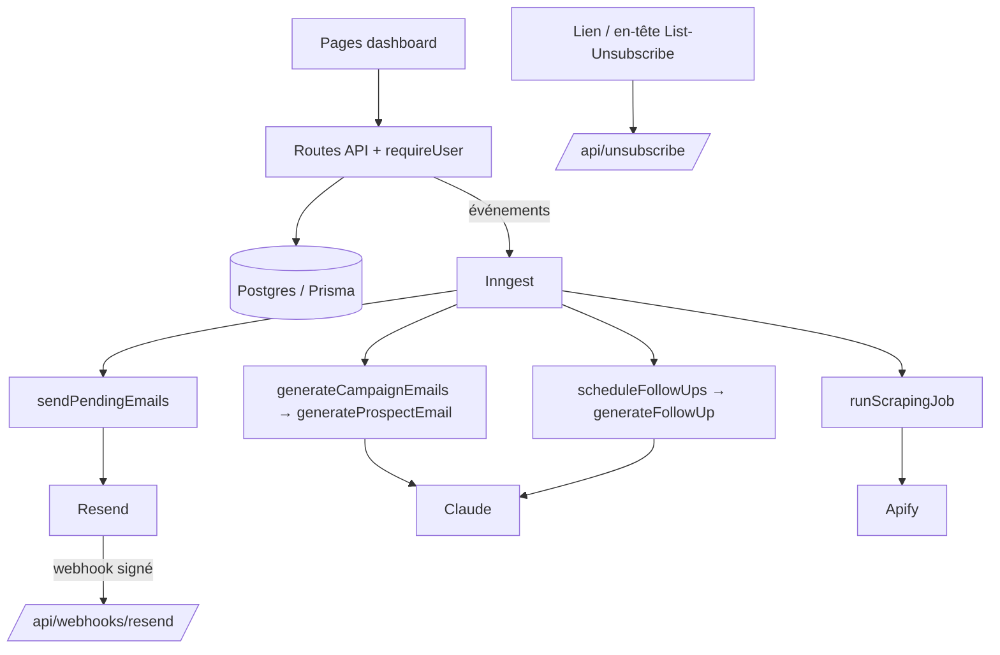

# SCPB Commercial — Contexte projet

## 1. Vue d'ensemble

Outil interne de prospection B2B de la filière cacao (équipe commerciale SCPB, siège au Cameroun) :
recherche de prospects, scoring, segmentation, rédaction d'emails par Claude, envoi progressif, relances, suivi.
Accès fermé sur invitation. Le module « partenaires financiers » a été retiré en novembre 2026
(colonnes `prospectType` / `financialCategory` / `ScrapingJob.kind` conservées en base, toujours filtrées sur `COMMERCIAL`).

## 2. Stack

Next.js 16 (App Router, `src/proxy.ts`), React 19, TypeScript, Tailwind 4, shadcn/ui (Base UI), Prisma 7 + PostgreSQL (Supabase),
Supabase Auth, Anthropic SDK (`claude-sonnet-5-5`, sortie structurée zod), OpenAI (secours), Resend, Apify, Inngest 4, Vitest.
Gestionnaire de paquets : **pnpm** uniquement.

## 3. Architecture

Principes :
- **Un seul chemin d'envoi** : `deliverEmail()` (`src/lib/sending.ts`) appelée par la fonction Inngest `send-pending-emails`.
  Réservation atomique `PENDING → SENDING`, clé d'idempotence Resend = id de l'email, quota global du jour (fuseau `APP_TIMEZONE`),
  exclusion des prospects `UNSUBSCRIBED` / `COLD` et de la table `suppressions`.
- **Validation humaine** : les emails générés restent `PENDING` ; seule une campagne `ACTIVE` envoie.
- **Relances** : `computeDueFollowUps()` (`src/lib/followups.ts`) part du dernier email de la séquence.
- **Scraping** : `src/lib/scraping/pipeline.ts`, découpé en étapes Inngest reprenables, plafonds dans `SCRAPING_LIMITS`.
- **Accès** : `src/proxy.ts` (session) + `requireUser(roles?)` dans chaque route + `getCurrentUser()` dans le layout.

## 4. Fichiers clés

| Fichier | Rôle |
|---|---|
| `src/lib/auth.ts` | membre actif, rôles, `ADMIN_EMAILS` / `ALLOWED_EMAIL_DOMAINS` |
| `src/lib/sending.ts` | quota, suppression, réservation, envoi |
| `src/lib/resend.ts` | HTML/texte, pied légal, en-têtes de désinscription |
| `src/lib/email-events.ts` | machine d'états des webhooks (monotone, idempotente) |
| `src/lib/campaign-generation.ts` | cibles, rédaction initiale et relances |
| `src/lib/claude.ts` | prompts, sortie structurée, bascule OpenAI sur erreurs transitoires |
| `src/lib/labels.ts` | libellés et couleurs de statut uniques pour l'UI |
| `src/lib/dashboard.ts` | données du tableau de bord (requêtes groupées) |
| `src/inngest/functions.ts` | toutes les tâches de fond |

## 5. Données

Modèles : `User` (rôle, `active`), `Prospect`, `Segment`, `ProspectSegment`, `Campaign`, `Email`
(unicité `campaignId + prospectId + type`, statut `SENDING`), `Response`, `ScrapingJob`, `AppSettings`
(dont `companyAddress`), `Suppression`, `WebhookEvent`, `EmailTemplate` (non utilisé), `ProspectNote`.
RLS activée sur toutes les tables (l'API REST Supabase n'y a pas accès ; Prisma passe par le rôle propriétaire).
Pays stockés de préférence en ISO2 (`normalizeCountryToIso2`).

## 6. Charte graphique « Terroir & Soleil »

Dérivée du logo : olive `#4E5A1F` (primaire), soleil `#F7AD21` (accent), feuille `#94A538`, olive très foncé `#26300F` (menu),
crème `#F8F3EA` (fond). Titres Fraunces, texte Inter. Tokens dans `src/app/globals.css` (`--primary`, `--sun`, `--success`…).
Monogramme : `public/brand/mark.png` (favicon `src/app/icon.png`). L'IA reste discrète (`AIBadge`, un marqueur sobre).
Textes en français accentué, vouvoiement.

## 7. Conventions

- Routes API : `requireUser()` en tête, corps validé par zod via `parseJsonBody()`, erreurs via `serverError()` (pas de message interne au client).
- Pas de `window.confirm` : `useConfirm()` (`src/components/shared/confirm-dialog.tsx`).
- Statuts affichés via `<StatusBadge kind=… value=… />`.
- Liens stylés en bouton : `<Link className={buttonVariants()}>` (jamais `<Link><Button>`).
- Tests : `src/lib/__tests__/*.test.ts` sur la logique pure.

## 8. Limites connues / prochaines étapes

- Réponses entrantes non automatisées (marquage manuel « Le prospect a répondu ») ; `classifyResponse` prête.
- Modèles d'emails réutilisables, planification par date (`scheduledFor` respecté mais sans UI), journal d'audit.
- Migration destructive des colonnes financières à prévoir après export.

## 9. Historique

- [2026-11-11] Relance : sécurité (accès fermé, RLS, webhook signé), Claude Sonnet 5.5, envoi conforme et idempotent via Inngest,
  scraping reprenable et plafonné, qualité des données, refonte UI « Terroir & Soleil », retrait du module financier, tests et CI.
- [2026-05] Module partenaires financiers (retiré depuis), robustesse Postgres.
- [2026-04] Version initiale : dashboard, prospects, segments, scraping, campagnes, envoi, paramètres.
